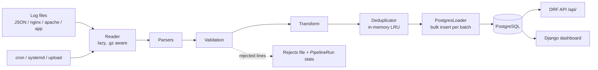
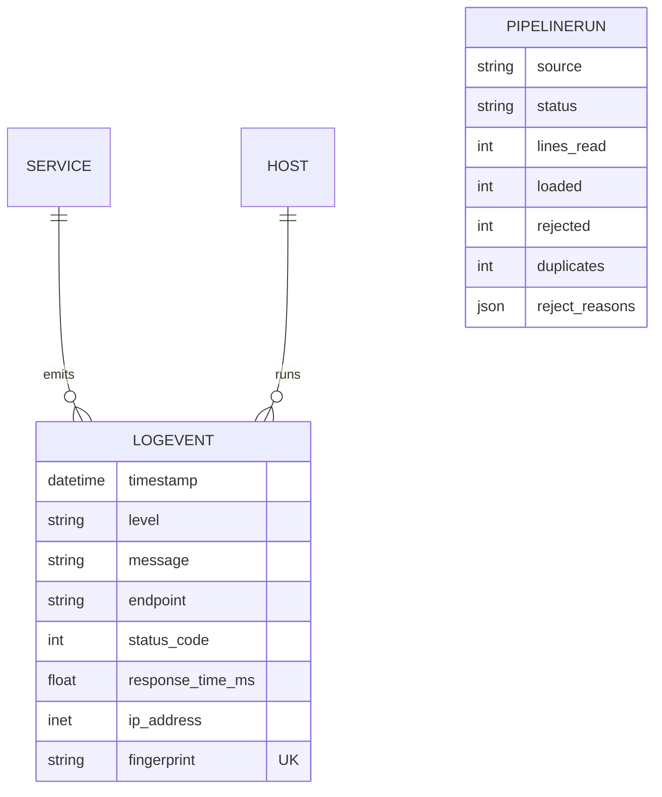

# LogPulse — Log Analytics & Monitoring Platform

LogPulse ingests raw log files (JSON Lines, nginx/apache access logs, plain application logs), validates and
normalises them with a batched, idempotent Python ETL, stores them in PostgreSQL, and exposes them through a
REST API (Django REST Framework) and a Django dashboard with charts, a filterable log explorer and pipeline history.

**Stack:** Python 3.12 · Django 5.1 · Django REST Framework · PostgreSQL 16 · Bash/Linux (cron, systemd) · Docker Compose

## Architecture



The `pipelines/` package is pure Python with no Django dependency, so parsing, validation, dedupe and the ETL loop are
unit-tested without a database. `apps/ingestion/loader.py` plugs the PostgreSQL loader into it.

## Data model



Indexes: `timestamp`, `(level, timestamp)`, `(service, timestamp)`, `status_code`, `endpoint`. Check constraints enforce
valid levels and status-code range; `fingerprint` is unique (sha256 of the normalised event).

## ETL behaviour

- **Batched:** lines are streamed and processed in batches (`LOGPULSE_BATCH_SIZE`, default 1000), so memory is O(batch).
- **Validation:** timestamps (several formats), level aliases, HTTP method, status 100–599, response-time units, IP address. Each rejection has a reason recorded in `PipelineRun.reject_reasons`.
- **Idempotent:** every event has a fingerprint. An in-memory LRU catches repeats within a run; the database unique constraint (`bulk_create(ignore_conflicts=True)`) catches repeats across runs. Re-running a file inserts nothing new.
- **Transactions:** one transaction per batch. Run status is `SUCCESS`, `PARTIAL` (some rejects) or `FAILED`.
- **Input notes:** JSON input must be JSON Lines (one object per line). `.gz` files are read transparently.

## Setup (Ubuntu)

```bash
git clone <your-repo> logpulse && cd logpulse
sudo ./scripts/setup_ubuntu.sh      # apt packages, PostgreSQL role/db, venv, pip install, .env, migrate
```

Manual equivalent:

```bash
sudo apt install -y python3-venv postgresql libpq-dev
sudo -u postgres psql -c "CREATE USER logpulse WITH PASSWORD 'logpulse';"
sudo -u postgres psql -c "CREATE DATABASE logpulse OWNER logpulse;"
python3 -m venv .venv && source .venv/bin/activate
pip install -r requirements.txt
cp .env.example .env
python manage.py migrate
python manage.py createsuperuser    # optional, for /admin/
```

## Run the app

```bash
./scripts/start_app.sh              # migrate + runserver on 0.0.0.0:8000 (or: python manage.py runserver)
```

Open http://localhost:8000/ (dashboard), `/logs/` (explorer), `/pipelines/` (runs and upload), `/api/`.

## Docker

```bash
docker compose up --build
```

Starts PostgreSQL 16 (with healthcheck) and the web container, which migrates, collects static files, seeds demo data
(`LOGPULSE_SEED_DEMO=1`) and serves via gunicorn on http://localhost:8000.

## Generate sample logs

Committed samples live in `sample_logs/` (`access.log`, `application.log`, `events.jsonl`, `mixed_with_errors.log`).
To generate more:

```bash
python manage.py generate_logs --count 50000 --days 3 --output sample_logs/generated.log
python manage.py generate_logs --count 1000 --format nginx --seed 7 --output -
./scripts/generate_logs.sh 20000 sample_logs/big.log
```

Options: `--format mixed|json|nginx|app`, `--days`, `--end`, `--seed`, `--bad-ratio`, `--duplicate-ratio`.

## Run the ETL

```bash
python manage.py process_logs sample_logs/access.log sample_logs/application.log sample_logs/events.jsonl
python manage.py process_logs sample_logs/mixed_with_errors.log --rejects-file rejected/mixed.rejects
python manage.py process_logs some.log.gz --service billing --host bill-01 --batch-size 500
python manage.py seed_demo --count 10000       # generate and load demo data in one step
./scripts/run_etl.sh incoming_logs/            # processes every file, moves to processed_logs/ or failed_logs/
```

Expected result for the mixed sample: some lines rejected (with reasons) and duplicates skipped; running the same
command again loads 0 new rows.

## Linux automation

- `linux/logpulse.cron`: ETL every 5 minutes (`run_etl.sh`, guarded by `flock`) and nightly DB backup at 02:30.
- `linux/logpulse.service`: systemd unit running gunicorn. Install with
  `sudo cp linux/logpulse.service /etc/systemd/system/ && sudo systemctl daemon-reload && sudo systemctl enable --now logpulse`.
- `scripts/backup_db.sh`: `pg_dump | gzip` with retention (`LOGPULSE_BACKUP_RETENTION_DAYS`).
- Adjust `/opt/logpulse` in the cron and unit files to your install path.

## REST API

| Endpoint | Description |
|---|---|
| `GET /api/logs/` | Paginated logs (50/page) |
| `GET /api/logs/<id>/` | Single log event |
| `GET /api/services/` | Services with event counts |
| `GET /api/analytics/` | Summary, time series, breakdowns, top endpoints and errors, window-function reports |
| `GET /api/pipelines/` | Pipeline run history |
| `POST /api/pipelines/` | Upload a log file (multipart `file`); 201 on success, 422 if it fails |

Filters for `/api/logs/` and `/api/analytics/`: `level`, `service`, `host`, `status_code` (e.g. `404` or `5xx`),
`endpoint` (contains), `q` (message contains), `range` (`1h|24h|7d|30d|all`), `start`, `end` (ISO date/datetime).
Invalid values return 400. Analytics uses SQL window functions (`AVG() OVER` moving average, `LAG`, `ROW_NUMBER`).

> The API is open (`AllowAny`) for demo purposes. Add authentication before exposing it publicly.

## Tests

```bash
# Pure-Python ETL tests (no database needed)
python3 -m unittest tests.test_parsers tests.test_validation tests.test_dedupe tests.test_etl

# Full suite (models, loader, analytics, API, views) — needs PostgreSQL and the configured DB user with CREATEDB
python manage.py test
```

## Project layout

```
config/      settings, urls, wsgi/asgi
pipelines/   pure-Python ETL: parsers, validation, transform, dedupe, reader, etl, generator
apps/logs/   models, filters, serializers, API, explorer views
apps/ingestion/  PostgresLoader, run services, upload API, management commands
apps/analytics/  aggregation queries, window functions, dashboard, API
templates/ static/  UI
scripts/ linux/     Bash automation, cron, systemd
tests/  sample_logs/  Dockerfile  docker-compose.yml
```
